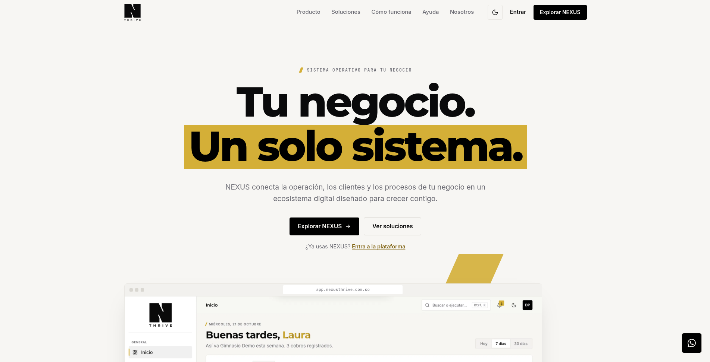

<p align="center">
  
</p>

<h1 align="center">NEXUS THRIVE · Web</h1>

<p align="center">
  <strong>La cara pública de NEXUS.</strong><br>
  Landing, centro de ayuda y páginas legales de la plataforma que ordena la operación de las pymes colombianas.
</p>

<p align="center">
  <a href="https://nexusthrive.com.co"><strong>Ver el sitio</strong></a> ·
  <a href="https://app.nexusthrive.com.co">Abrir la aplicación</a> ·
  <a href="https://nexusthrive.com.co/help">Centro de ayuda</a> ·
  <a href="https://github.com/NexusThrive/nexus-thrive">Repositorio de la app</a> ·
  <a href="https://github.com/NexusThrive/nexus-thrive/blob/main/docs/nexus-architecture/product-vision.md">Visión de producto</a>
</p>

<p align="center">
  
  
  
  
  
</p>

<p align="center">
  
</p>

<p align="center"><sub>Captura real del Inicio de NEXUS en modo claro, con datos de demostración.</sub></p>

## ¿Qué es NEXUS?

NEXUS es una plataforma **multi-negocio (SaaS)** para pymes en Colombia.
Reúne en un solo lugar lo que hoy suele estar repartido entre un cuaderno o
Excel para los clientes, WhatsApp para atenderlos, una caja o app para cobrar,
un software contable para facturar y nada para que el negocio aparezca en
internet.

La idea es que **el negocio opere el día entero desde NEXUS**: vender, cobrar,
facturar, controlar inventario y caja, atender clientes, agendar, gestionar
membresías y accesos, y hacerse visible. Cada rubro ve su propia versión del
producto —un gimnasio ve socios, membresías y control de acceso; un museo ve
taquilla y aforo; una constructora ve obras, APU y actas— pero por debajo son
las mismas capacidades combinadas.

Este repositorio es la **superficie pública** de ese producto:

| Ruta | Contenido |
| --- | --- |
| `/` | Landing: qué es NEXUS, módulos, caso gimnasio, método de trabajo, equipo y contacto |
| `/help` | Centro de ayuda con guías paso a paso de lo que la app hace hoy |
| `/help/<guía>` | Una página por guía, con pasos, errores frecuentes y enlaces relacionados |
| `/privacidad`, `/terminos`, `/cookies` | Páginas legales |
| `/404`, `/gracias` | Página de error y confirmación después del contacto |

La aplicación real vive en
[`NexusThrive/nexus-thrive`](https://github.com/NexusThrive/nexus-thrive) y se
abre en [app.nexusthrive.com.co](https://app.nexusthrive.com.co).

## ¿Qué queremos lograr?

Queremos que NEXUS sea **el sistema operativo del negocio de una pyme
colombiana**, no otro ERP aislado ni un software contable más:

- **Adaptarse al rubro, no al revés.** El vocabulario, los campos y los módulos
  cambian según el negocio; el motor de datos es el mismo.
- **La operación diaria primero, la contabilidad después.** Cada venta y cada
  gasto se registran bien desde el inicio, con su documento, para entregárselos
  al contador o a su software.
- **Cada capacidad sirve sola y mejor acompañada.** El inventario funciona sin
  POS; con POS descuenta solo. La agenda funciona sin mensajería; con mensajería
  avisa sola.
- **El dinero no se equivoca.** Todo cobro es transaccional, con recibo
  consecutivo, trazabilidad y anulación auditada.
- **Integrar antes que construir** lo que ya es commodity regulado: factura
  electrónica DIAN, pasarela de pagos, WhatsApp Business y correo.
- **Colombia de fábrica.** Pesos, NIT, cédula, DIAN, WhatsApp como canal
  principal y medios de pago locales.

La ruta de construcción está ordenada en seis fases: base estable; esquema único
y capacidades; vender y facturar; cobrar y avisar solos; que lo encuentren; y
ecosistema contable. El detalle está en la
[visión de producto](https://github.com/NexusThrive/nexus-thrive/blob/main/docs/nexus-architecture/product-vision.md)
y el plan técnico en el
[roadmap](https://github.com/NexusThrive/nexus-thrive/blob/main/docs/nexus-architecture/roadmap.md).

## Tecnologías

| Capa | Tecnología | Uso |
| --- | --- | --- |
| **Sitio** | Astro 7 | Generación estática, rutas y componentes `.astro` |
| **Lenguaje** | TypeScript | Tipado en datos, componentes y configuración |
| **Estilos** | CSS con variables · tokens `--nx-*` | Sistema de marca NEXUS, modo claro y oscuro, sin framework de UI |
| **Iconos** | `@lucide/astro` | Iconografía de la landing y la ayuda |
| **Tipografía** | Montserrat · Inter · JetBrains Mono | Fuentes autoalojadas en `public/fonts` |
| **Imágenes** | WebP · `passthroughImageService` | Capturas reales ya optimizadas, sin procesamiento en el build |
| **Analítica** | Plausible | Medición básica de clics en WhatsApp y en el acceso a la app |
| **Calidad** | `check:brand` · build de Astro | Verificación de tokens contra la marca oficial y compilación estática |
| **Entorno** | Node.js ≥ 22.12 · pnpm 12 | Desarrollo y build |

## Puesta en marcha

```bash
pnpm install
pnpm dev            # o: astro dev --background
pnpm build
pnpm preview
pnpm check:brand    # los primitivos --nx-* coinciden con la marca de la app
```

El servidor de desarrollo en segundo plano se controla con `astro dev status`,
`astro dev logs` y `astro dev stop`.

## Estructura

```
src/pages/                  Landing, ayuda, legales, 404 y gracias
src/components/landing/     Secciones de la landing
src/components/brand/       Logo oficial (lockup y marca)
src/data/site.ts            Contenido verificable de la landing
src/data/help.ts            Guías y preguntas del centro de ayuda
src/assets/product/         Capturas reales de la app en claro y oscuro
src/styles/tokens.css       Primitivos y semánticos de la marca
src/styles/global.css       Base, layout y utilidades
public/                     Íconos, fuentes, manifest y cabeceras
scripts/check-brand-tokens.mjs  Verificación de tokens y de la página 404
docs/capturas/              Evidencia visual de cambios de la ayuda
```

## Marca

La fuente de la marca es `packages/brand/css/tokens.css` del repositorio de la
app (`nexus-thrive`), documentada en su `DESIGN.md`. Aquí se copian los
primitivos en `src/styles/tokens.css`; `pnpm check:brand` falla si se
desalinean. No se agregan colores, fuentes ni radios propios.

Reglas principales:

- Negro dominante, papel y blanco como base, oro como único acento.
- Radios casi rectos (2–8 px), bordes en lugar de sombras.
- Un solo motivo gráfico: el corte diagonal de la N.
- El logo es la N con THRIVE debajo; no se recolorea ni se le añaden efectos.

## Contenido y capturas

- **Solo se publica lo que la app hace hoy**, con los nombres que se ven en
  pantalla. Antes de escribir un paso se verifica en el código de
  `nexus-thrive`.
- Las capturas salen de la app real con datos de demostración, en
  `src/assets/product/<nombre>-light.webp` y `-dark.webp`. Nunca se usan datos
  de clientes reales.
- Cuando cambia un flujo en la app, en el mismo ciclo se actualiza su guía y,
  si cambió la pantalla, su captura.
- Las páginas legales y la landing tampoco prometen funciones que todavía no
  existen: lo planificado se marca como "en desarrollo".

## Despliegue

El build genera un sitio estático en `dist/` con el dominio configurado
`https://nexusthrive.com.co`. Las cabeceras de seguridad y de caché están en
`public/_headers`; las fuentes y capturas se sirven con caché inmutable.

---

<p align="center"><sub>NEXUS THRIVE · Hecho en Colombia para que operar un negocio sea más simple.</sub></p>
